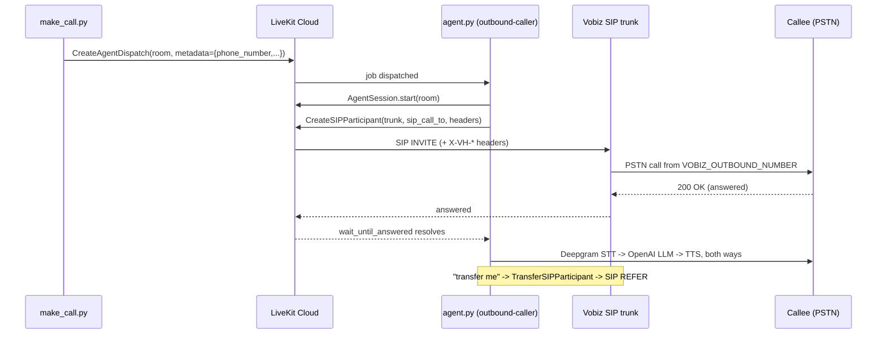

# Vobiz + LiveKit — Outbound Calling Agent

An AI voice agent that places outbound phone calls over a Vobiz SIP trunk, waits for a real answer, holds a natural conversation, and hands the caller to a human on request.

[](./LICENSE)
[](https://www.python.org/)
[](https://docs.livekit.io/agents/)
[](https://docs.vobiz.ai)

## Overview

This repository is a complete, runnable example of **agent-initiated outbound calling**. A dispatcher script asks LiveKit to start a job; the agent worker picks the job up, joins a room, and dials a PSTN number through a Vobiz SIP trunk. Once the call is answered, a speech-to-text → LLM → text-to-speech pipeline runs for the duration of the conversation, and a function tool lets the agent perform a SIP REFER transfer to a human.

The distinction that matters for outbound is *who dials whom*. In an inbound example the carrier delivers a call to your agent and the agent is simply present when the caller arrives. Here the agent is the originator: it creates a SIP participant with `wait_until_answered=True`, so the code after the dial only runs once a human has genuinely picked up — not on ringing, and not on a network-level 200.

The agent is built on [LiveKit Agents](https://docs.livekit.io/agents/) with Deepgram for transcription, OpenAI for reasoning, and either OpenAI or Cartesia for speech synthesis, selected at runtime by an environment variable. Vobiz supplies the SIP trunk, the DID used as caller ID, and the PSTN termination. LiveKit's `BVCTelephony` noise-cancellation model is applied to the room input, which is tuned for the narrowband audio you get on a phone line.

By the end of the setup below you will have two terminals: one running a registered agent worker, one dispatching calls to arbitrary E.164 numbers. Everything is configured through a single `.env` file — no source edits are required to run it.

## What you can build with it

- **Appointment reminders and confirmations** — dial a list of customers, confirm or reschedule by voice, and transfer to the front desk when the caller wants to speak to a person.
- **Payment and renewal follow-ups** — place a call, verify intent conversationally, and REFER to a billing team member for anything the agent should not handle.
- **Lead qualification callbacks** — call an inbound web lead within seconds, ask qualifying questions, then warm-transfer qualified prospects straight to a sales rep.
- **Service and delivery notifications** — outbound status calls where the recipient can ask follow-up questions rather than listening to a fixed recording.
- **Surveys and post-interaction feedback** — a short spoken questionnaire that adapts to what the respondent actually says.
- **Correlated outbound campaigns** — attach a `X-VH-CorrelationId` header to the INVITE so every call can be joined back to a row in your CRM.

## How it works

`make_call.py` never touches SIP. It creates an **agent dispatch**: a request telling LiveKit to run the worker named `outbound-caller` in a freshly generated room, with the target number carried as JSON job metadata. The worker started by `agent.py` is already registered under that name, so LiveKit routes the job to it.

The worker parses the metadata, starts an `AgentSession`, and then calls `create_sip_participant`. LiveKit's SIP service sends the INVITE to Vobiz using the credentials stored on the outbound trunk. Vobiz terminates the call on the PSTN with your DID as the caller ID. When the callee answers, the SIP leg is bridged into the same LiveKit room as an audio participant, and the STT/LLM/TTS loop starts.

Transfer runs over the same trunk. The `transfer_call` tool builds a `sip:<number>@<VOBIZ_SIP_DOMAIN>` URI and issues a `TransferSIPParticipantRequest`, which LiveKit converts into a SIP REFER. Vobiz routes the referred leg and the agent drops out.



## Architecture

| File | Responsibility |
| --- | --- |
| `agent.py` | The worker. Registers as `outbound-caller`, builds the `AgentSession` (Deepgram STT, OpenAI LLM, OpenAI/Cartesia TTS, Silero VAD, BVC telephony noise cancellation), places the outbound SIP call, exposes the `transfer_call` tool, and logs every SIP attribute a participant carries. |
| `make_call.py` | The dispatcher. Validates the destination, packs `phone_number`, optional `from_number`, and optional `sip_headers` into job metadata, and creates the agent dispatch. Does not place the call itself. |
| `setup_trunk.py` | One-off helper that pushes `VOBIZ_SIP_DOMAIN`, `VOBIZ_USERNAME`, `VOBIZ_PASSWORD`, and `VOBIZ_OUTBOUND_NUMBER` onto an existing LiveKit outbound trunk via `update_outbound_trunk_fields`. |
| `transfer_call.md` | Detailed guide to configuring and debugging SIP REFER cold transfers, with a SIP status-code troubleshooting table. |
| `INBOUND-CALL-CORRELATION.md` | How to join a LiveKit session to its Vobiz CDR record using `sip.callIDFull` ↔ `bridge_uuid`. |
| `.env.example` | Template for every environment variable the code reads. |
| `requirements.txt` | Python dependencies (LiveKit Agents 1.5+, the plugin set, `python-dotenv`). |

Inside `agent.py` the notable pieces are:

| Symbol | Purpose |
| --- | --- |
| `entrypoint(ctx)` | Job entrypoint. Parses metadata, starts the session, dials out, and falls back to a greeting when no `phone_number` is present (so the same worker can serve an inbound room). |
| `OutboundAssistant` | The `Agent` subclass carrying the system instructions — introduce yourself, stay concise, call `transfer_call` immediately when asked. |
| `TransferFunctions.transfer_call` | LLM function tool. Normalises the destination into a SIP URI, resolves the SIP participant identity, and issues the REFER. |
| `_build_tts()` | Reads `TTS_PROVIDER` and returns either an OpenAI or Cartesia TTS instance, with model and voice overridable per provider. |
| `_log_sip_participant(p)` | Dumps `sip.callID`, `sip.callIDFull`, `sip.trunkID`, `sip.phoneNumber`, `sip.trunkPhoneNumber`, and any forwarded `sip.h.*` headers. This is the raw material for CDR correlation. |

## Prerequisites

| Requirement | Notes |
| --- | --- |
| Python 3.9 or newer | The LiveKit Agents 1.5 line targets modern CPython. |
| [uv](https://github.com/astral-sh/uv) (recommended) | Any virtualenv tool works; `uv` is used in the commands below because it is fast. |
| A [LiveKit Cloud](https://cloud.livekit.io) project | You need the project URL (`wss://…`), an API key, and an API secret. |
| A LiveKit **outbound SIP trunk** | Created once with `lk sip outbound create` or in the LiveKit dashboard. Its id (`ST_…`) goes into `OUTBOUND_TRUNK_ID`. |
| A [Vobiz](https://vobiz.ai) account with SIP trunking | From the [Vobiz console](https://console.vobiz.ai) you need the SIP domain, SIP username, SIP password, and at least one DID to use as caller ID. |
| An OpenAI API key | Used for the LLM (`gpt-4o-mini`) and, by default, for TTS. |
| A Deepgram API key | Used for streaming STT (`nova-3`, multilingual). |
| A Cartesia API key | Optional — only when `TTS_PROVIDER=cartesia`. |

No public tunnel (ngrok or similar) is required. The agent worker dials *out* to LiveKit Cloud over a websocket, so it runs happily behind NAT.

## Setup

1. **Clone the repository and enter it.**

   ```bash
   git clone https://github.com/vobiz-ai/LiveKit-Vobiz-Outbound.git
   cd LiveKit-Vobiz-Outbound
   ```

2. **Create a virtual environment and install the dependencies.**

   ```bash
   uv venv
   uv pip install -r requirements.txt
   ```

   With plain pip: `python -m venv .venv && source .venv/bin/activate && pip install -r requirements.txt`.

3. **Create your environment file.** The scripts load `.env` from the directory they live in, so the filename matters.

   ```bash
   cp .env.example .env
   ```

4. **Fill in `.env`.** Every variable is documented in [Configuration](#configuration). At minimum you need the three LiveKit values, `OPENAI_API_KEY`, `DEEPGRAM_API_KEY`, `OUTBOUND_TRUNK_ID`, and the four `VOBIZ_*` values.

5. **Create the LiveKit outbound trunk** if you do not already have one, and put its id in `OUTBOUND_TRUNK_ID`:

   ```bash
   lk sip outbound create
   ```

6. **Sync your Vobiz credentials onto the trunk.**

   ```bash
   uv run python setup_trunk.py
   ```

   A successful run prints the trunk id, address, username, and number list, followed by a confirmation. This step is what prevents the "max auth retry attempts" failure described in [Troubleshooting](#troubleshooting).

7. **Whitelist the LiveKit SIP signalling addresses** on your Vobiz trunk if your account is configured with IP-based access control, and confirm the DID in `VOBIZ_OUTBOUND_NUMBER` is authorised for outbound caller ID.

## Configuration

All configuration lives in `.env`, loaded from the directory containing the script. Variables marked *implicit* are read by the SDK or plugin rather than by this repository's code, but they must still be present.

| Variable | Required | Default | Description |
| --- | --- | --- | --- |
| `LIVEKIT_URL` | Yes | — | Your LiveKit project websocket URL, e.g. `wss://your-project.livekit.cloud`. Read explicitly by `make_call.py`; implicit for the worker. |
| `LIVEKIT_API_KEY` | Yes | — | LiveKit API key from Project Settings → Keys. |
| `LIVEKIT_API_SECRET` | Yes | — | LiveKit API secret paired with the key above. |
| `OUTBOUND_TRUNK_ID` | Yes | — | Id of the LiveKit outbound SIP trunk (`ST_…`) used for `create_sip_participant`. Read by `agent.py` and `setup_trunk.py`. |
| `VOBIZ_SIP_DOMAIN` | Yes | — | Vobiz SIP domain, e.g. `your_sip_domain.sip.vobiz.ai`. Written onto the trunk by `setup_trunk.py`, and used by `agent.py` to build the transfer SIP URI. |
| `VOBIZ_USERNAME` | Yes | — | SIP authentication username. Consumed by `setup_trunk.py`. |
| `VOBIZ_PASSWORD` | Yes | — | SIP authentication password. Consumed by `setup_trunk.py`. |
| `VOBIZ_OUTBOUND_NUMBER` | Yes | — | Your Vobiz DID in E.164, used as the trunk's caller ID. Consumed by `setup_trunk.py`; overridable per call with `--from`. |
| `OPENAI_API_KEY` | Yes | — | Used for the `gpt-4o-mini` LLM, and for TTS when `TTS_PROVIDER=openai`. *Implicit.* |
| `DEEPGRAM_API_KEY` | Yes | — | Streaming STT (`nova-3`, `language="multi"`). *Implicit.* |
| `TTS_PROVIDER` | No | `openai` | Selects the speech synthesiser. Accepts `openai` or `cartesia`; matched case-insensitively, and anything unrecognised falls back to OpenAI. |
| `OPENAI_TTS_MODEL` | No | `tts-1` | OpenAI TTS model, used when `TTS_PROVIDER=openai`. |
| `OPENAI_TTS_VOICE` | No | `alloy` | OpenAI TTS voice. |
| `CARTESIA_API_KEY` | Only with Cartesia | — | Required when `TTS_PROVIDER=cartesia`. *Implicit.* |
| `CARTESIA_TTS_MODEL` | No | `sonic-2` | Cartesia model id. |
| `CARTESIA_TTS_VOICE` | No | `f786b574-daa5-4673-aa0c-cbe3e8534c02` | Cartesia voice id. |
| `DEFAULT_TRANSFER_NUMBER` | No | — | Destination the `transfer_call` tool dials when the caller does not name one. Without it the tool returns an error string to the LLM instead of transferring. |

## Running it

**Terminal 1 — start the worker.**

```bash
uv run python agent.py dev      # auto-reloads on file changes
# or
uv run python agent.py start    # no reload; use this for a long-running deployment
```

Wait for the registration line before dispatching anything:

```
INFO:livekit.agents:registered worker  id="AW_…" region="…"
```

Leave this terminal running. It is the process that will actually place calls, and its log is where you will see the SIP participant dump, the dial attempt, and any transfer.

**Terminal 2 — dispatch a call.**

```bash
uv run python make_call.py --to +15550003333
```

Expected output:

```
Initiating call to +15550003333...
Session Room: call-15550003333-4821

✅ Call Dispatched Successfully!
Dispatch ID: AD_…
```

Terminal 1 then logs `Connecting to room: call-…`, the participant attribute dump, `Initiating outbound SIP call to +15550003333...`, and finally `Call answered! Agent is now listening.` once the callee picks up.

**Override the caller ID** with any number authorised on your trunk:

```bash
uv run python make_call.py --to +15550003333 --from +15550004444
```

**Attach custom SIP headers** to the INVITE — repeat the flag for more than one. Vobiz forwards headers in the `X-VH-*` namespace, and the script warns you if a key falls outside it:

```bash
uv run python make_call.py --to +15550003333 \
  --header X-VH-CorrelationId=crm-4471 \
  --header X-VH-Campaign=renewals-q3
```

**Ask for a transfer** while on the call. Say "transfer me" for `DEFAULT_TRANSFER_NUMBER`, or "transfer me to +1 555 000 4444" for a specific destination. See [transfer_call.md](transfer_call.md) for the full REFER walkthrough and SIP status-code table.

By default the agent does **not** speak first — it waits to hear the callee's "hello". To make it open the conversation, uncomment the `session.generate_reply(...)` block in `entrypoint()` immediately after the dial succeeds.

## Command and SDK reference

### `make_call.py` flags

| Flag | Required | Repeatable | Description |
| --- | --- | --- | --- |
| `--to` | Yes | No | Destination in E.164, must start with `+`. Also becomes part of the generated room name. |
| `--from` | No | No | Caller ID override. Must be authorised on the trunk. Omit to use the trunk's configured number. |
| `--header` | No | Yes | `KEY=VALUE` SIP header added to the INVITE. Keys should begin with `X-VH-`; other keys are passed through with a warning and will be dropped by Vobiz. |

### Job metadata contract

`make_call.py` JSON-encodes this object into the dispatch metadata, and `entrypoint()` parses it back:

| Key | Type | Description |
| --- | --- | --- |
| `phone_number` | string | Destination. Its absence is what makes the worker treat the room as inbound. |
| `from_number` | string, optional | Passed to `create_sip_participant` as `sip_number`. |
| `sip_headers` | object, optional | Header name → value map forwarded on the INVITE. |

### LiveKit SIP surface used

| Call | Where | Notes |
| --- | --- | --- |
| `api.CreateAgentDispatchRequest` | `make_call.py` | `agent_name="outbound-caller"` must match `WorkerOptions(agent_name=…)` in `agent.py`. |
| `api.CreateSIPParticipantRequest` | `agent.py` | Uses `wait_until_answered=True`, `participant_identity=f"sip_{number}"`, `headers`, `include_headers=SIP_X_HEADERS`, and `sip_number` for caller-ID override. |
| `api.TransferSIPParticipantRequest` | `agent.py` | Cold transfer via SIP REFER, `play_dialtone=False`. |
| `sip.update_outbound_trunk_fields` | `setup_trunk.py` | Sets `address`, `auth_username`, `auth_password`, and `numbers` on an existing trunk. |

### SIP participant attributes logged

| Attribute | Meaning |
| --- | --- |
| `sip.callIDFull` | The Vobiz ↔ LiveKit leg's SIP Call-ID. Equals `bridge_uuid` in the Vobiz CDR — this is the correlation key. |
| `sip.callID` | LiveKit-internal identifier. Not a CDR join key. |
| `sip.callStatus` | Current state of the SIP leg. |
| `sip.trunkID` | The LiveKit trunk that carried the leg. |
| `sip.phoneNumber` | The remote party's number. |
| `sip.trunkPhoneNumber` | The DID on your side of the call. |
| `sip.h.*` | Forwarded SIP headers, present only when the trunk maps them. |

Full correlation walkthrough, including the Vobiz CDR query: [INBOUND-CALL-CORRELATION.md](INBOUND-CALL-CORRELATION.md).

## Troubleshooting

| Symptom | Likely cause | Fix |
| --- | --- | --- |
| Dispatch succeeds but nothing happens in terminal 1 | No worker is registered under `outbound-caller`, or the two processes point at different LiveKit projects. | Confirm terminal 1 printed `registered worker`. Check that `agent_name="outbound-caller"` in `agent.py` matches `agent_name` in `make_call.py`, and that both read the same `LIVEKIT_URL`. |
| `Error: LIVEKIT_URL / LIVEKIT_API_KEY / LIVEKIT_API_SECRET missing in .env` | `.env` was not created, or was created with a different name. | Run `cp .env.example .env` in the repository root and fill it in. The scripts load `.env` from their own directory, so the name must be exactly `.env`. |
| `Error: Phone number must start with '+' and country code.` | `--to` was given in national format. | Pass full E.164, e.g. `--to +15550003333`. |
| `Failed to place outbound call: … max auth retry attempts` (SIP 500) | The LiveKit trunk does not carry your current Vobiz SIP username and password. | Run `uv run python setup_trunk.py`. Re-run it any time you rotate the SIP password. |
| `Failed to place outbound call` with an invalid-argument error, and `OUTBOUND_TRUNK_ID` logged as `None` | `OUTBOUND_TRUNK_ID` is missing from `.env`, so `sip_trunk_id` is empty. | Create the outbound trunk, copy its `ST_…` id into `.env`, and restart the worker so the value is re-read. |
| `Error: OUTBOUND_TRUNK_ID not found in .env` from `setup_trunk.py` | Same missing variable, caught by the explicit guard in the setup script. | As above. |
| Call rings but the agent never speaks and no transcript appears | STT or TTS credentials are wrong, so the pipeline fails after answer. | Check `DEEPGRAM_API_KEY` and `OPENAI_API_KEY`. If `TTS_PROVIDER=cartesia`, confirm `CARTESIA_API_KEY` is set too. Errors surface in the terminal 1 log. |
| Callee sees the wrong number, or the call is rejected outright | The caller ID is not authorised on the trunk. | Verify `VOBIZ_OUTBOUND_NUMBER` is a DID on your Vobiz account and that any `--from` override is also authorised. Re-run `setup_trunk.py` after changing it. |
| "Transfer me" answers `Error: No default transfer number configured.` | `DEFAULT_TRANSFER_NUMBER` is unset and the caller named no destination. | Set `DEFAULT_TRANSFER_NUMBER` in `.env`, or ask for a specific number on the call. |
| Transfer fails with SIP 408, 400, or an immediate disconnect | SIP URI or REFER routing issue. | See the dedicated status-code table in [transfer_call.md](transfer_call.md); confirm `VOBIZ_SIP_DOMAIN` is set and that SIP REFER is enabled on your trunk. |
| Log line `(no sip.h.* headers …)` on an outbound call | Headers you sent with `--header` are on the outgoing INVITE, not on the remote participant's attributes. | This is expected for outbound. Inbound header mapping requires the trunk's header-to-attribute configuration. |

## Security notes

- `.env` holds LiveKit API secrets, SIP credentials, and model provider keys. It is already covered by `.gitignore`; keep it that way and never commit a filled-in copy. Only `.env.example` with placeholder values belongs in the repository.
- SIP passwords are written to the LiveKit trunk by `setup_trunk.py`. Rotate them in the Vobiz console and re-run the script rather than leaving old credentials live.
- `setup_trunk.py` prints the SIP username to stdout. Be mindful of that when running it in shared CI logs.
- Outbound calls carry conversational audio and transcripts through Deepgram and OpenAI. Treat anything the callee says as personal data and apply your own retention policy; this example persists nothing.
- Values passed via `--header` travel on the SIP INVITE in clear text within the signalling path. Use opaque correlation ids, never personal data or secrets.
- Outbound calling is regulated. Respect calling-hours restrictions, do-not-call registries, and the disclosure requirements that apply in the jurisdictions you dial. The bundled instructions tell the agent to identify itself as an AI assistant when asked; keep that behaviour.

## Roadmap

> Planned improvements to this example. Ideas and pull requests are welcome —
> open an issue to discuss anything here.

- [ ] Retry policy for unanswered and busy calls, with configurable backoff and a maximum attempt count, instead of the current single fire-and-forget dial.
- [ ] A campaign driver that reads a CSV or database of contacts and paces dispatches against a concurrency limit, so `make_call.py` is not a one-number-at-a-time tool.
- [ ] Answering-machine detection, so voicemail is handled differently from a live human — see the companion [Machine Detection Agent example](https://github.com/vobiz-ai/Livekit-Vobiz-Machine-Detection-Agent-example) for the pattern to fold in.
- [ ] Persist call outcomes (disposition, transcript, transfer target, `sip.callIDFull`) to a datastore and join them to the Vobiz CDR automatically, rather than reading them out of terminal logs.
- [ ] Structured logging and metrics — per-call latency for STT, LLM, and TTS, plus answer and transfer rates — exported to an observability backend.
- [ ] A test suite: unit coverage for metadata parsing, header validation, and SIP URI construction in `transfer_call`, with the LiveKit API mocked so calls are not placed.
- [ ] Warm transfer as an alternative to the current cold REFER, keeping the agent on the line to brief the human before it drops.

Related examples in this organisation: [Inbound agent](https://github.com/vobiz-ai/Livekit-vobiz-inbound) · [Call transfer](https://github.com/vobiz-ai/Vobiz-Livekit-Call-Transfer-Example) · [IVR and DTMF](https://github.com/vobiz-ai/Vobiz-Livekit-IVR-DTMF-Example) · [Agent-to-agent handoff](https://github.com/vobiz-ai/Vobiz-Livekit-Agent-to-Agent-Handoff-Example) · [Post-call analysis](https://github.com/vobiz-ai/Livekit-Vobiz-Post-Call-Analysis) · [Webhook and CRM integration](https://github.com/vobiz-ai/Livekit-Vobiz-Webhook-Integration-Example)

## Contributing

Issues and pull requests are welcome — bug reports, clearer documentation, and additional examples all help.

Before opening a pull request:

1. Confirm the modules still import and compile:

   ```bash
   uv run python -m py_compile agent.py make_call.py setup_trunk.py
   ```

2. Run an end-to-end call against your own trunk and confirm the worker registers, the call connects, and a transfer completes.
3. Keep every configuration value in `.env` and document any new variable in both `.env.example` and the Configuration table above.
4. Never include real phone numbers, SIP credentials, or API keys in code, logs, or example output.

## License

Released under the [MIT License](./LICENSE) © Vobiz.

MIT is permissive: you may use, modify, and redistribute this code, including in
closed-source commercial products, provided the copyright notice and licence text
are retained. There is no warranty. If your organisation needs a different
licensing arrangement, contact [piyush@vobiz.ai](mailto:piyush@vobiz.ai).

## Built by Team Vobiz

[Vobiz](https://vobiz.ai) is a programmable voice and SIP-trunking platform for
voice APIs, SIP trunking, and AI voice agents. This repository is built and
maintained by the Vobiz team.

**Maintainer:** Piyush Sahoo — [piyush@vobiz.ai](mailto:piyush@vobiz.ai) · [LinkedIn](https://www.linkedin.com/in/piyush-s713/)

Questions, or want to talk through an integration? Open an issue on this repo,
or reach out directly at [piyush@vobiz.ai](mailto:piyush@vobiz.ai).

**Useful links:** [Docs](https://docs.vobiz.ai) · [API reference](https://docs.vobiz.ai/api-reference) · [Sign up](https://vobiz.ai)
